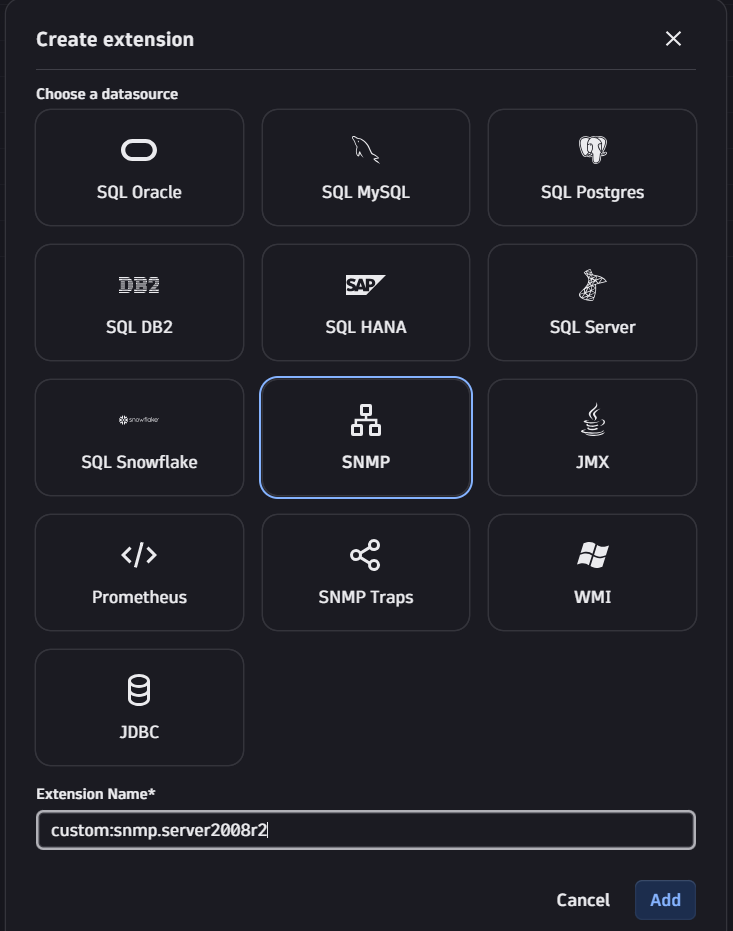
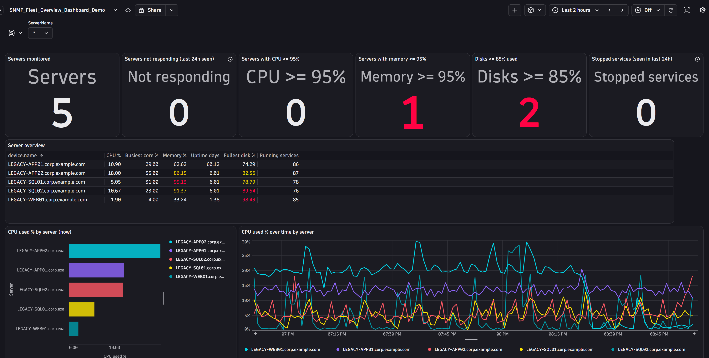
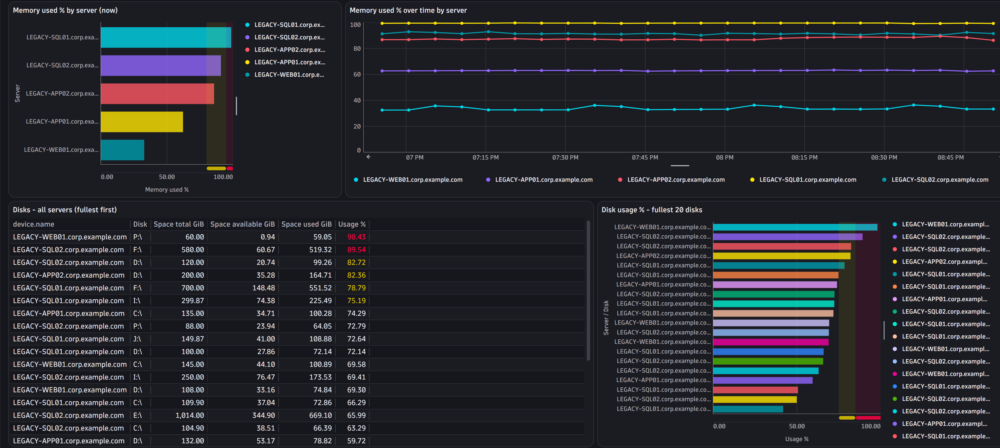
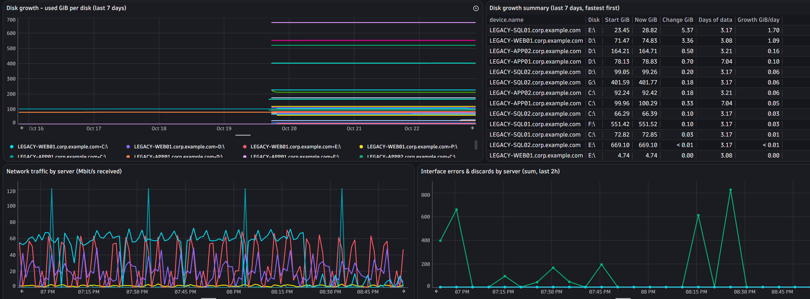
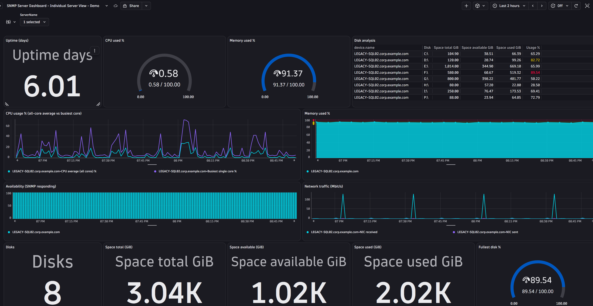
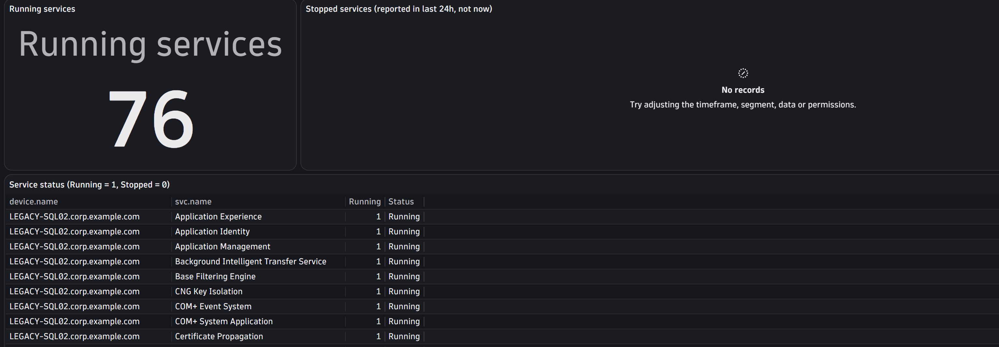

# snmp-2008r2

Custom Windows Server (2008 R2 and later legacy) SNMP extension for Dynatrace, built with the Extensions Creator app.

It is a **remote extension**: an ActiveGate polls the servers over SNMP, so nothing is installed on the monitored hosts other than the Windows SNMP Service.

## What it collects

Extension name: `custom:snmp.server2008r2` (see [extension.yaml](extension.yaml))

- System info and SNMP agent uptime, plus OS uptime (`hrSystemUptime`)
- CPU: all-core average and busiest core
- Memory and disk usage (filterable by storage description)
- Network interface traffic (filterable by description and type)
- Running Windows services (filterable by display name)
- SNMP availability (is the server responding)

Optional filter variables are available in the monitoring configuration: `storage_path`, `interface_descr`, `interface_type` and `service_name`. They use Dynatrace pattern syntax, for example `$prefix(C:)`, `$eq(6)` or `$or($prefix(SQL),$contains(MSSQL))`.

## Prerequisites

1. **ActiveGate** with the Extensions Execution Controller (EEC) enabled, which can reach the target servers.
2. **Certificates**: you must sign the extension with your own certificate, and the matching root/CA certificate must be uploaded to the ActiveGate (and the Dynatrace credential/certificate store as required by your environment). Dynatrace will not run an unsigned custom extension. See the Dynatrace docs on [signing extensions](https://docs.dynatrace.com/docs/ingest-from/extensions/develop-your-extensions/sign-extensions).
3. **SNMP Service installed and configured on each destination Windows host** (Server Manager > Features > SNMP Service). Set the community string and add the ActiveGate's IP as a permitted host.
4. **Network access**: allow SNMP from the ActiveGate to the target hosts in the Windows firewall and any network firewalls (default **UDP 161**).

## Installation

1. Install the **Extensions Creator** app from the Dynatrace Hub / App launcher.
2. Create a new extension: choose **SNMP** as the datasource and name it `custom:snmp.server2008r2`.

   

3. Switch to the **YAML** view and replace its contents with [extension.yaml](extension.yaml) from this repo.
4. **Sign and deploy** the extension using your own certificates.
5. Create a monitoring configuration: select the ActiveGate group, add the target hosts and SNMP credentials, and set any optional filters.

## Dashboards

Two example dashboards are included. Import them into Dynatrace via **Dashboards > Upload**.

| Dashboard | File |
|---|---|
| Fleet overview | [SNMP_Fleet_Overview_Dashboard.json](SNMP_Fleet_Overview_Dashboard.json) |
| Individual server view | [SNMP Server Dashboard - Individual Server View.json](<SNMP Server Dashboard - Individual Server View.json>) |

### Fleet overview

### Individual server view

